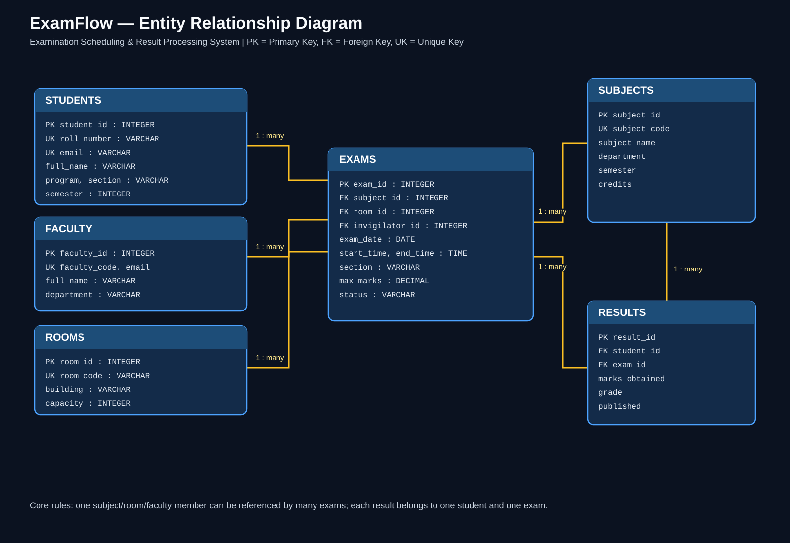
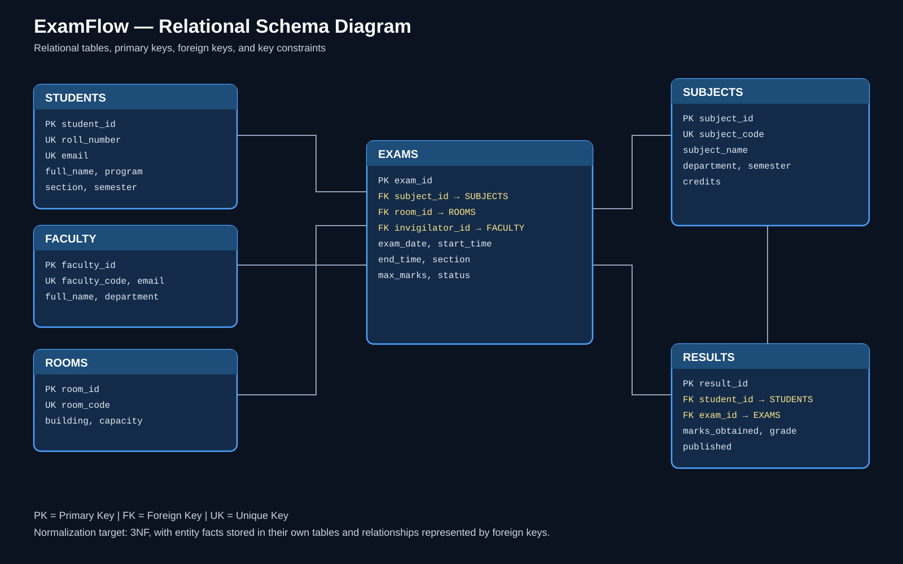

# ExamFlow ER diagrams

These diagrams are part of the DBMS project documentation.

## 1. Entity Relationship Diagram (ERD)

Editable source: [ER_DIAGRAM.mmd](ER_DIAGRAM.mmd)

## 2. Relational Schema Diagram

The schema shows the primary keys (PK), foreign keys (FK), and unique keys (UK) used by the prototype. Use the SVGs in reports and presentations; they remain sharp when zoomed or printed.

## Relationship summary

- One subject can have many exam instances.
- One room can host many exam instances at different times.
- One faculty member can invigilate many exams, subject to timetable-conflict rules.
- One student can have many result records.
- One exam can produce many student result records.

**Note:** The ERD documents the current prototype structure. Verify constraints and normalization against the final SQL schema before final submission.
